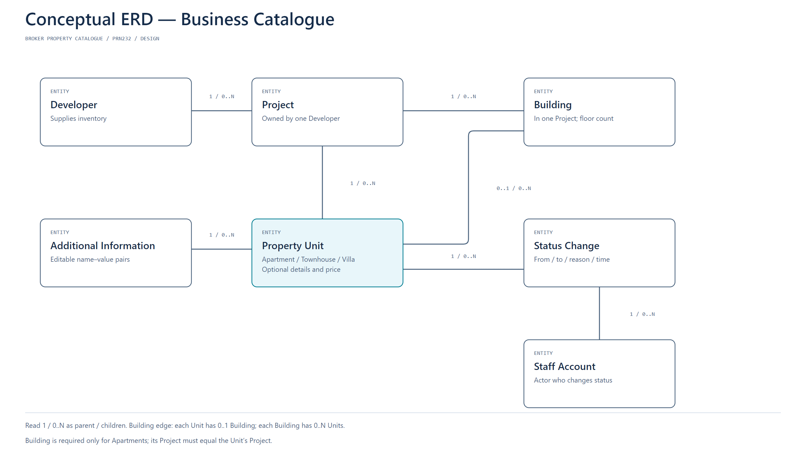
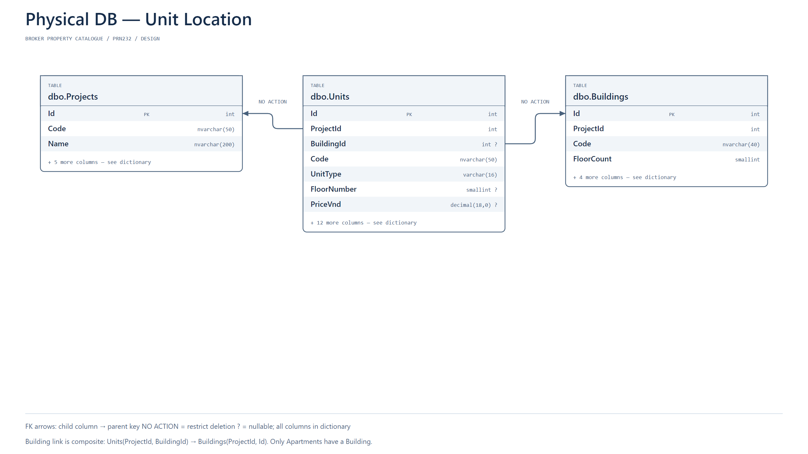
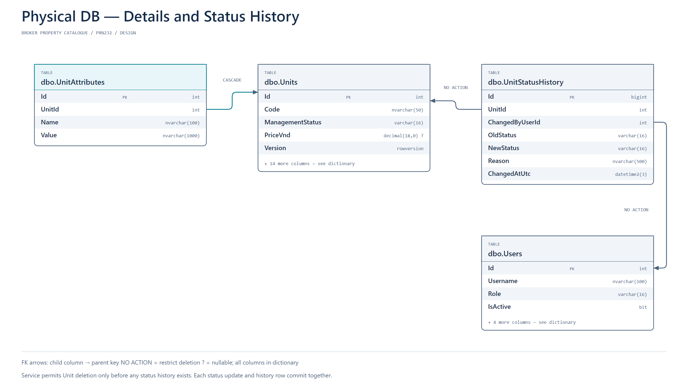
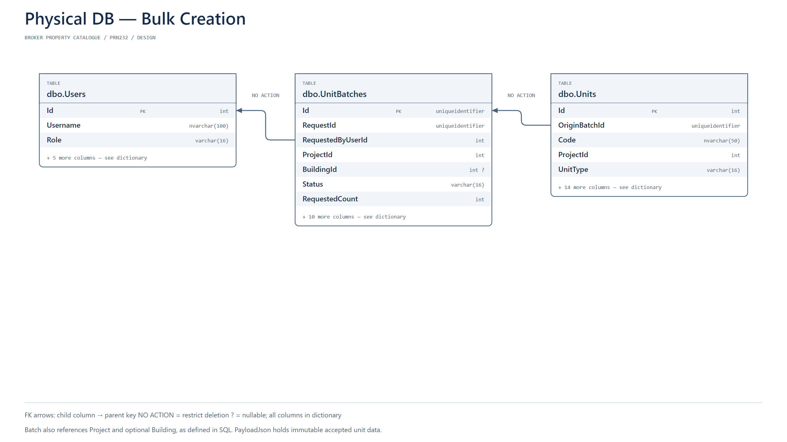
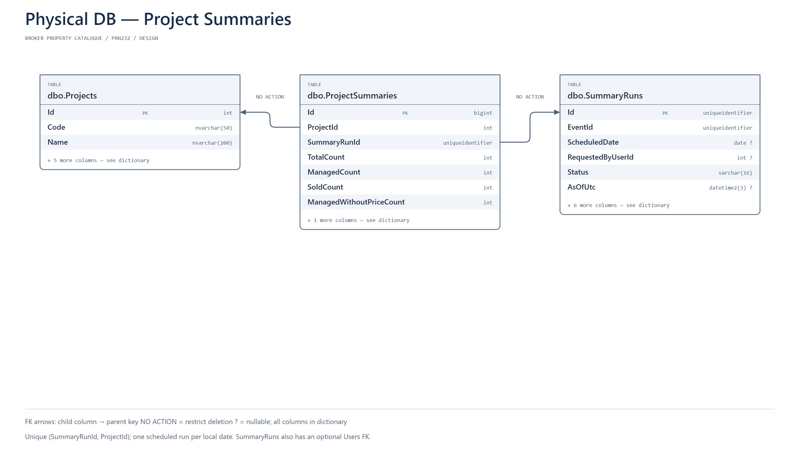
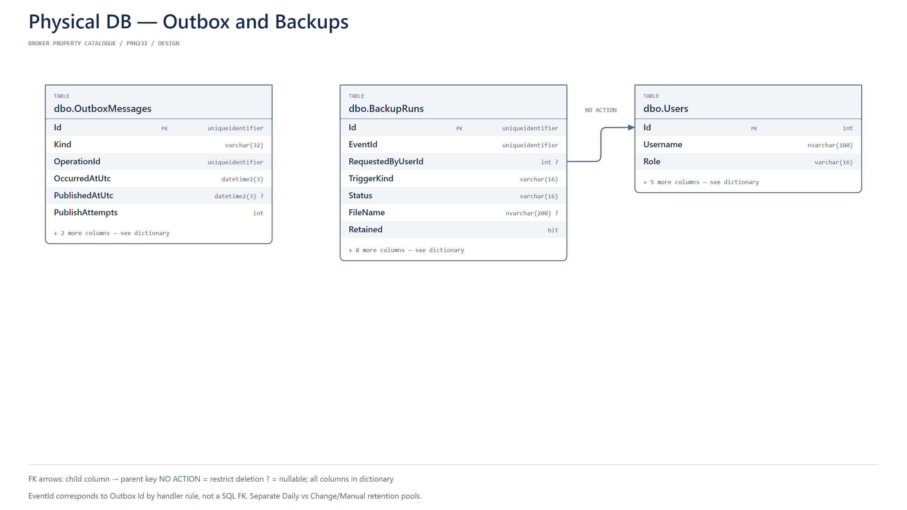

# Broker Property Catalogue — System Design

**PRN232 Final Assignment · Approved scope · 14 October 2026**

This document specifies an assignment-sized system for a three-person team working over approximately two to three weeks. It describes the intended implementation; the application has not been built yet. The approved interview decisions are preserved in [discovery.md](discovery.md). Implementation details below resolve routine design choices within that scope.

## 1. Context

A real-estate broker receives inventories from property developers and manages the units allocated to its organization. Developer-provided information can be incomplete: area measurements, bedroom counts, garden area, and other attributes may arrive later. Employees need to create many units quickly, update their details and prices, and record when units are sold or transferred away from the broker.

The catalogue represents **one broker organization**. Developers are catalogue entities and sources of information; they do not log into this application. Employees enter the supplied data manually. There is no developer-system integration and no customer portal.

The domain hierarchy is:

- One Developer owns zero or more Projects; each Project has exactly one Developer.
- One Project contains zero or more Buildings and Property Units.
- An Apartment belongs to exactly one Building in the same Project.
- A Townhouse or Villa belongs directly to a Project and has no Building association in this version.
- A Building's floor count, an Apartment's floor number, and a house's own floor count are separate concepts.

## 2. Problems

| Problem | Effect on broker employees |
|---|---|
| Repeated manual entry for large inventories | Creating hundreds of units takes time and produces inconsistent codes. |
| Incomplete details from developers | Requiring every measurement prevents employees from recording otherwise valid units. |
| Prices are supplied after allocation | A missing price can be mistaken for a zero price or block creation. |
| Allocation changes and sales lack a trace | Employees cannot explain who changed management status or why. |
| Catalogue statistics require manual counting | Employees cannot quickly see managed inventory and units awaiting a price. |
| Changes are not backed up consistently | The team cannot demonstrate recovery of its catalogue database. |

## 3. Solutions

Provide a small React application backed by a layered ASP.NET Core REST API. Employees maintain developers, projects and buildings; preview generated codes; create up to 500 units per batch; add missing details; enter prices; and change management status with an audit trail.

An independent gRPC service generates deterministic unit codes. Redis Streams carries asynchronous work. A .NET Worker creates batches, produces project summaries, and requests SQL Server backups after successful business-data mutations and on a daily schedule.

Unknown descriptive values are stored as `NULL`, not invented zeroes. Flexible extra details are editable name/value pairs. The design uses one relational database and one Worker deployment to keep the scope achievable.

### Scope boundaries

Included: internal catalogue management, Admin/Employee login, unit generation, pricing entry, status history, summaries, backups, Docker Compose and assignment demonstration.

Excluded: payments, deposits, contracts, customer CRM, commission accounting, price formulas, price history, developer integration, image uploads, cloud backup, multi-tenant brokerage accounts, full dynamic field-definition systems, per-project permissions, and production operations. Marking a unit Sold records a catalogue status only.

## 4. Main Actors

| Actor | Responsibilities and permissions |
|---|---|
| Employee | View all catalogue data; CRUD developers/projects/buildings; preview and submit batches; edit unit details/additional information; enter or correct prices; change status; view status history and project summaries; request a summary refresh. |
| Admin | All Employee capabilities, plus create/update/deactivate accounts, request backups, and inspect backup results. |
| Developer / CĐT | External business stakeholder that supplies unit information and allocation changes through existing offline channels. Not an application account. |

Worker and gRPC services are technical elements, not human business actors. There is no public registration. Seed the first Admin using deployment configuration; hash passwords with ASP.NET Core's password hasher. Login returns a short-lived JWT. Validate signature, issuer, audience, expiry and role on the API. A deactivated user is rejected by authenticated endpoints even if an earlier token has not expired; check active account state. Do not expose hashes or log credentials/tokens.

## 5. Main Features

### 5.1 Master data

| Entity | Required information | Optional information |
|---|---|---|
| Developer | Code, name | Contact name, email, phone |
| Project | Code, name, Developer | Address, description |
| Building | Code, name, Project, floor count | Classification: HighRise or LowRise |

Developer and Project codes are unique within this broker catalogue. Building codes are unique within their Project. The user selects building classification if known; the application does not infer a regulatory height threshold.

Delete a Developer only if it has no Projects; a Project only if it has no Buildings, Units or retained Batch records; a Building only if it has no Units or retained Batch records. Return a clear conflict message rather than deleting children. Historical summary snapshots also restrict Project deletion. Users are deactivated, not physically deleted.

### 5.2 Unit fields and missing information

All units require code, type and Project. Apartments additionally require Building and floor number. Management status defaults to Managed. Descriptive values remain optional for every type because the broker may not receive complete information.

| Field | Apartment | Townhouse | Villa |
|---|---|---|---|
| Usable area, m² | Optional | Not used | Not used |
| Land area, m² | Not used | Optional | Optional |
| Building footprint area, m² | Not used | Optional | Optional |
| Own floor count | Not used | Optional | Optional |
| Bedroom / bathroom count | Optional | Optional | Optional |
| Garden area, m² | Not used | Not used | Optional |
| Total price, VND | Initially empty; entered later | Initially empty; entered later | Initially empty; entered later |
| Additional information | Editable name/value pairs | Editable name/value pairs | Editable name/value pairs |

Area values, when supplied, must be positive. Room counts can be zero but not negative; a supplied own floor count must be positive. A supplied garden area can be zero. No rule compares garden/footprint area to land area because supplied measurements may use different definitions. Label footprint area explicitly to avoid confusing it with the sum of all floor areas.

Additional names are unique within a unit, with trimmed case-insensitive comparison. Store values as plain text; do not execute them or inject HTML. No filtering, typed formulas or custom-field schema is provided. A batch may share an initial set of extra fields, copied separately to each unit.

### 5.3 Bulk generation and preview

**Apartments:** choose Project/Building, start floor, end floor, units per floor and shared optional attributes. Codes use the building code, a separator and zero-padded floor/unit sequence: `A-0101`, `A-0102`, …, `A-0510`. Use at least two digits for each numeric part and widen consistently for larger numbers. Restrict the initial version to floors and units-per-floor in 1–99, with floor range inside the Building's floor count; total units must be 1–500. Floor numbering is numeric and continuous; basements, skipped floors and irregular per-floor layouts can be handled as separate batches or subsequent edits within supported bounds.

**Townhouses/Villas:** choose Project, a prefix, start number, quantity and shared attributes. Codes such as `NP-001`–`NP-020` or `BT-001`–`BT-010` use at least three digits, widening consistently if the end number is larger. Allow positive starting numbers, quantity 1–500 and a final code length of at most 50 characters. Prefixes contain letters, digits and hyphens; normalize codes to uppercase and trim spaces.

The gRPC service accepts a numbering specification and returns the generated codes and apartment floor numbers. It has no database and does not decide availability. The REST API validates parent relationships, field values and duplicate codes against SQL Server. Preview does not reserve codes or create units; changing input invalidates the preview.

Confirmation submits the specification and a client request identifier. The API generates/validates the canonical preview again and stores the accepted immutable unit payload as JSON in a Batch record; this prevents trusting a tampered preview. Return `202 Accepted` with the Batch resource URL. Request identifiers are unique: a replay with the same request and user returns the existing Batch; a replay with different payload is a conflict.

The Worker creates all units in one SQL transaction. It rechecks parent existence, floor bounds and code uniqueness at execution time. A concurrent request may therefore pass preview but fail during creation. On failure create no units, set Batch Failed and record a readable cause. On success set Completed and the created count in the same transaction. React polls the Batch endpoint while the page is open. The status is Queued, Processing, Completed or Failed; duplicate delivery must not create a second set of units.

### 5.4 Prices

New units have `PriceVnd = NULL` and display **No price yet**. An Employee edits a unit's total price after creation. Store whole VND using `decimal(18,0)`; a known price must be greater than zero. Reject negative, zero or fractional VND rather than silently rounding. Clearing a mistaken price restores `NULL`. No automatic area multiplication, mass pricing or price-history feature is required.

### 5.5 Management status and history

| Status | Meaning |
|---|---|
| Managed | The unit is currently allocated to this broker's catalogue. |
| Unmanaged | The unit is no longer allocated to this broker, including transfer to another broker. |
| Sold | An Employee has recorded that the unit was sold. |

Employees may change between these statuses, including correcting a mistaken Sold status. Require a nonempty reason and record actor, UTC time, old/new status. A no-op status submission produces no history or backup event. Multi-select status changes are one transaction, up to 500 units; either all selected versions match and all changes succeed, or none do.

Initial creation sets Managed without adding a status-history row. A mistakenly created unit may be physically deleted only while it has no status-history records. Deletion removes its additional information and triggers a backup request. Once it has history, preserve the unit and use Unmanaged. Status history is immutable through application endpoints. React sends the SQL rowversion on updates/deletes; stale edits return `409 Conflict` and require a reload.

### 5.6 Search and catalogue pages

Search by code and filter by Developer, Project, Building, type, status, price presence and total price range. No-price rows are excluded from numeric price ranges. Sort by code, creation time or price, with `Id` as a stable tie-breaker; explicitly place missing prices last. Default page size 20, maximum 100. The API accepts only allowlisted sort fields.

React screens: login; developers; projects; buildings; unit catalogue; batch wizard/preview; Batch progress; unit details with price, attributes and history; summary dashboard; and Admin account/backup pages. All authenticated users see the same organization's catalogue. All dates are stored in UTC and displayed in Vietnam time.

### 5.7 Daily and manual project summaries

At **00:05 Asia/Ho_Chi_Minh**, the Worker computes project totals, Managed/Unmanaged/Sold counts, and Managed units without a price. Count units directly, avoiding joins that multiply rows through attributes/history. Produce all projects' rows for one SummaryRun in a consistent SQL snapshot transaction; enable `ALLOW_SNAPSHOT_ISOLATION` during database setup. A manual refresh creates another run.

Dashboard reads the latest completed run and displays its `AsOfUtc`; it is not presented as live data. Projects added afterward display **Awaiting summary**. `SummaryRuns` provides status/error visibility. One successful scheduled run is allowed for each Vietnam calendar date; retry an unfinished/failed run rather than creating duplicates. For a single Worker, a timer checks local date/time and persisted run state; a restart after the scheduled time performs the day's missed run.

### 5.8 Backup after changes, daily backup and recovery

Back up the entire SQL Server database at **00:15 Asia/Ho_Chi_Minh**, on Admin request, and after each successful logical transaction changing business data: accounts, Developers, Projects, Buildings, Units, prices, attributes or management status. One 500-unit batch produces one backup request after its creation transaction. No changes means no backup event. Initial seed/migration is followed by an explicit baseline backup.

Record a BackupRequested outbox event in the same transaction as a business change. Summary snapshots, Batch progress, outbox delivery bookkeeping and BackupRun updates do not trigger change backups; otherwise backup completion would cause an endless loop. Manual and scheduled requests have their own events. The Worker processes backup requests sequentially, without merging change requests. A backlog is visible in the Admin page.

The API returns business success after the data commit, without waiting for the backup. Backup failure does not undo the business operation. A backup captures the SQL Server state while it executes and can include later commits; it is **not** a precise snapshot immediately after each edit. There is no point-in-time recovery guarantee and no transaction-log backup chain in this assignment.

Use full `COPY_ONLY` backups with checksums and unique server-generated filenames. The SQL Server process writes `.bak` files to `/var/opt/mssql/backup`, mounted from a separate Docker named volume. The Worker mounts that volume at the same path for retention cleanup; both containers need appropriate access. Keep backup credentials separate from normal API credentials. SQL Server's backup permission is required; do not give the normal API login `sysadmin`.

Verify completed files with `RESTORE VERIFYONLY ... WITH CHECKSUM`. This is a file/readability check, not a substitute for restoring and checking data. Mark a BackupRun successful only after backup and verification succeed. Keep **7 successful daily files and 7 successful change/manual files**; remove older files only after a new verified backup and record their `Retained = 0`. Never count failed attempts in the retention limit or delete the last good backup because a new attempt failed.

BackupRun is keyed by its event ID to tolerate repeated delivery. On interrupted attempts, retry to a new unique filename and clean orphan files only after verified success. The database copy may contain the current backup's Running record because the completion update occurs afterward; this is expected. Local backups share the host's failure domain. See [backup-and-restore.md](backup-and-restore.md) for SQL templates and a restore drill.

## 6. System Architecture (C4)

### Level 1 — System Context

Admin and Employee use the Broker Property Catalogue. The Developer is shown as an external stakeholder supplying data offline to employees, not as a connected software integration. There are no external software systems in the approved scope.

### Level 2 — Container

| Container / store | Responsibility |
|---|---|
| React Web, served by Nginx | Internal forms, previews, status polling, catalogue and dashboard; `/api` proxy to REST API. |
| ASP.NET Core REST API | JWT, authorization, validation, CRUD, preview orchestration, durable job requests, queries. |
| Numbering gRPC Service | Stateless deterministic code generation; internal HTTP/2 endpoint. |
| .NET Worker | Outbox relay, Redis consumer groups, bulk creation, scheduled/manual summaries and serial backups. |
| SQL Server | Catalogue, accounts, audit history, Batch records, summaries, outbox and backup results. |
| Redis Streams | Asynchronous delivery of Batch, Summary and Backup requests. |
| Backup Volume | Durable `.bak` files; mounted into SQL Server and Worker. A file store, not an independently executing service. |

The Worker is both a **producer** (outbox relay publishes using XADD) and a **consumer** (XREADGROUP dispatches jobs); business requests originate in the API or Worker transaction. Diagram arrows distinguish who initiates a connection from where records move. SQL Server creates backup files; Worker cleans old files. Redis has its own volume with AOF enabled, but SQL remains the authoritative job/request record.

REST API internals use **API → Services → Repository**. Controllers map HTTP; Services enforce business rules and transaction boundaries; Repositories use EF Core. Shared domain/persistence libraries can be reused by API and Worker, without creating separate deployments. No C4 Level 3 or Level 4 is included.

### Reliable asynchronous workflow

1. API stores Batch/summary request or commits a business mutation together with an OutboxMessage.
2. Worker relay reads unsent outbox rows, publishes to the appropriate Redis Stream, then marks publication. Failure between publish and marking can cause duplicates.
3. Consumer reads messages in a named consumer group. Payloads carry IDs; the Worker loads authoritative data from SQL.
4. Handler uses the Batch/Run's durable identity and SQL transaction to avoid repeated effects. ACK only after durable completion or recorded terminal failure.
5. Reclaim messages pending after a crash using XAUTOCLAIM. Retry transient failures with backoff; after three attempts record Failed and expose the error. Manual retry reuses the operation identity; do not blindly create a new batch.
6. On startup, reconcile nonterminal SQL operations and republish if necessary, even if an old outbox row says Published. This prevents Redis loss leaving jobs silently stuck. An active operation lease/heartbeat distinguishes a slow job from a crashed one.

One Worker instance is sufficient. Use independent hosted loops/scopes for relay, bulk jobs, summaries and serial backups so a slow backup does not stop catalogue creation. The application promises idempotent business effects under at-least-once delivery, not exactly-once messaging.

## 7. Technology

| Technology | Selected baseline | Reason |
|---|---|---|
| .NET / ASP.NET Core | .NET 10 LTS | Meets .NET 8-or-later requirement; longer supported window than .NET 8. |
| Persistence | EF Core 10 + SQL Server provider | Align major version with runtime; relational validation and transactions. |
| Database | SQL Server 2022 Developer, Linux container | Local assignment development; shared database for API/Worker. |
| Frontend | React + TypeScript, Vite | Small forms/dashboard; no SSR requirement. |
| Authentication | JWT bearer + ASP.NET password hashing | Explicit assignment requirement and simple internal roles. |
| Messaging | Redis 7.x Streams + StackExchange.Redis | Consumer groups and reclaiming pending work. |
| RPC | Grpc.AspNetCore, Grpc.Net.Client, Protobuf | Independent code generator callable by REST API. |
| Background jobs | .NET Worker / BackgroundService | One deployment with small hosted loops, no additional scheduler platform. |
| Local deployment | Docker Desktop Linux containers + Compose | Six executing services: Web, API, gRPC, Worker, SQL and Redis. |
| API documentation | OpenAPI/Swagger UI | Interactive API demonstration and JWT testing. |

Pin exact supported package/image patch versions and lockfiles during implementation; do not invent current patch numbers in this design. Verify .NET 10 support on lab machines at kickoff; .NET 8 is a compatible course fallback if required, but its support ends 10 November 2026 according to the [official .NET policy](https://dotnet.microsoft.com/en-us/platform/support/policy/dotnet-core).

SQL data, Redis data and backup files use separate named volumes. Nginx exposes the Web locally and proxies `/api`; SQL/Redis/gRPC remain internal by default. For local container communication, configure the gRPC endpoint explicitly as HTTP/2 without TLS; public TLS/gRPC exposure is outside this demo. [Microsoft's gRPC guidance](https://learn.microsoft.com/en-us/aspnet/core/grpc/aspnetcore?view=aspnetcore-10.0) documents this protocol requirement.

Configuration contains connection strings, JWT settings, `Asia/Ho_Chi_Minh`, stream/group names, 500-unit batch cap and retention limits. Use `.env.example` placeholders, never committed real secrets. DI supplies scoped DbContexts inside each job, structured logging includes operation/event IDs, and API exception middleware emits ProblemDetails without SQL traces.

## 8. ERD (Conceptual)

This figure models the business catalogue only. Operational tables for reliable processing and backups are separate physical concerns.

| Relationship | Cardinality / rule |
|---|---|
| Developer → Project | 1 → 0..many; a Project has one Developer. |
| Project → Building | 1 → 0..many; a Building has one Project. |
| Project → Property Unit | 1 → 0..many; every Unit has one Project. |
| Building → Property Unit | 1 → 0..many Apartments; a Unit has 0..1 Building, required for Apartments. |
| Property Unit → Additional Information | 1 → 0..many name/value records. |
| Property Unit → Status Change | 1 → 0..many immutable changes. |
| Staff Account → Status Change | 1 → 0..many; every change has one actor. |

Apartment, Townhouse and Villa are Unit categories with different applicable fields. They do not require three independently maintained tables or APIs. No Customer, Contract or Payment entity exists.

## 9. Physical DB

SQL Server database: **BrokerCatalogue**. The full baseline DDL is [database/schema.sql](database/schema.sql); the readable table/column dictionary is [database/data-dictionary.md](database/data-dictionary.md). It is a design baseline, not a substitute for reviewed EF Core migrations.

Diagrams intentionally show key columns only; the dictionary and SQL include every column. Physical connectors attach FK columns to referenced key columns and are labelled `NO ACTION` or `CASCADE`.

| Table | Purpose |
|---|---|
| Users | Staff credentials, role, active flag; referenced actors cannot be deleted. |
| Developers | Developer master data. |
| Projects | Projects with Developer ownership. |
| Buildings | Building floor count/classification; composite key supports same-Project Unit/Batch validation. |
| UnitBatches | Durable accepted creation payload, request identity, progress/error/lease. |
| Units | Common unit fields and nullable type-specific fields, status, price, origin Batch. |
| UnitAttributes | Flexible names and values; unique per Unit. |
| UnitStatusHistory | Old/new status, reason, actor and change timestamp. |
| SummaryRuns | Scheduled/manual run identity, timestamp and outcome. |
| ProjectSummaries | Project counts attached to one completed run. |
| OutboxMessages | Durable asynchronous intent written with its triggering transaction. |
| BackupRuns | Event identity, trigger kind, filename, verification state, lease, retained flag/error. |

### Constraints and consistency

- Use `int IDENTITY` entity keys, `uniqueidentifier` request/event IDs, `datetime2(3)` UTC times, `decimal(12,2)` areas and `decimal(18,0)` prices.
- `rowversion` on mutable catalogue/account records and operational runs supports concurrency; it is not a timestamp.
- Unique `(ProjectId, Code)` prevents duplicate Units even when two workers race.
- Composite FK `(ProjectId, BuildingId)` ensures a Unit/Batch's Building belongs to its Project. Simple Project FK still covers direct Project units when BuildingId is NULL.
- Unit type CHECK constrains apartment Building/Floor and nulls inapplicable fields; separate checks validate supplied numeric values.
- Status is a constrained string, independent from nullable price.
- SQL FKs default to `NO ACTION`; attributes cascade only when an eligible Unit is deleted. History prevents Unit deletion. Service code enforces the broader eligibility rule in the same transaction.
- Summary row uniqueness `(SummaryRunId, ProjectId)` and scheduled run keys prevent duplicate rows/runs.
- Outbox and payload JSON CHECKs reject malformed JSON, but Services still validate payload structure and business meaning.
- Normalize/trim codes before persistence; SQL case-insensitive collation and unique constraints provide a backstop. Keep location identifiers/type stable after creation; correcting those identities is done by deleting an eligible mistake and recreating, rather than rewriting historical ownership.
- Index Project/status/type and price for catalogue queries; Unit/time for history; publication state/time for relay; run status/time for operations. Measure before adding more indexes.

## 10. API Surface and Service Contracts

| Resource / operation | Methods and behavior |
|---|---|
| `/api/auth/login` | POST credentials → JWT and role; invalid credentials 401. |
| `/api/users` | Admin GET/POST; PUT by ID; deactivate via PATCH active flag. |
| `/api/developers`, `/api/projects`, `/api/buildings` | GET list/detail, POST, PUT and DELETE with validation/restrict rules. |
| `/api/unit-previews` | POST numbering specification and shared fields → validated preview, no Units created. |
| `/api/unit-batches` | POST confirmed input/request ID → 202; GET by ID → progress/error. |
| `/api/unit-batches/{id}/retry` | POST retry a failed transient operation using the same accepted payload. |
| `/api/units` | GET searchable paginated catalogue; detail GET/PUT; eligible DELETE. Creation is through Batches. |
| `/api/units/{id}/price` | PATCH whole VND or NULL with rowversion. |
| `/api/unit-status-changes` | POST selected Unit IDs, expected versions, target status and reason; atomic, max 500. |
| `/api/units/{id}/status-history` | GET read-only audit list. |
| `/api/units/{id}/attributes` | GET, PUT full validated name/value list; one transaction. |
| `/api/summary-runs` | POST refresh → 202; GET run status. |
| `/api/project-summaries` | GET latest completed snapshot. |
| `/api/backups` | Admin POST manual request → 202; GET run list/status. No file download or restore endpoint. |

gRPC contract: `UnitNumbering.GeneratePreview(specification)` → repeated `{code, floorNumber?}`. Include type, buildingCode for Apartments, start/end floors, unitsPerFloor or prefix/startNumber/quantity. Client deadline: 5 seconds; generator errors map to 400, temporary unavailability to 503. It does not access SQL or assign prices.

Redis streams: `catalogue:units`, `catalogue:summaries`, `catalogue:backups`; respective consumer groups. Messages contain EventId, OperationId, schema version and kind. Keep accepted JSON payload in SQL, not an untrusted message body. ACK completed work; retain stream entries through pending processing and trim only safe acknowledged history. Never use a trimming limit that removes unhandled messages.

## 11. Assignment Traceability and Verification Plan

| PDF requirement | Design evidence | Demonstration / meaningful check |
|---|---|---|
| REST API + core CRUD | Master-data and Unit endpoints; layered API | Create/edit/search/delete eligible data; show restricted deletion. |
| JWT | Admin/Employee roles | Login; anonymous rejection; Employee denied backup/account management. |
| Searching/filtering/sorting/pagination | Catalogue endpoint | Missing-price filter, project/status filters, stable pages. |
| EF Core + relational DB | Physical schema + migrations | Inspect FKs; reject cross-Project Building and duplicate codes. |
| Independent gRPC service | UnitNumbering container | Show API-to-gRPC preview; stop generator and observe 503 without creating Units. |
| Producer + consumer | Outbox relay XADD and Worker XREADGROUP | Publish/consume a Batch; inspect group; retry duplicate safely. |
| Background job | Bulk creation, summaries, backups | Return 202, show completion; run summary and backup manually. |
| Containerization/deployment | Compose topology | Start all containers and demonstrate internal connections. |
| End-to-end business workflow | Developer → Project → Building → Batch → price/status → summary/backup | One complete flow with PNG architecture explanation. |
| Source/DB scripts/Dockerfiles/OpenAPI/README | Delivery checklist | Verify all artifacts are submitted. |

Required integration scenarios: duplicate code after preview produces zero partial inserts; re-delivered completed Batch creates no duplicates; SQL commit followed by Redis outage eventually processes from outbox; stale rowversion rejects an overwrite; status audit and status update commit together; no-price differs from zero; backup failure leaves a visible error and does not create recursive requests; restore to an isolated database reproduces known unit counts/details. Automated checks should target these boundaries rather than every trivial getter.

## 12. Three-Person Delivery Plan

| Owner | Primary work | Integration responsibility |
|---|---|---|
| Member A | REST API, JWT, Services/Repository, EF schema/migrations | Shared DTOs, DB constraints and API contracts. |
| Member B | React screens, catalogue filters, preview/Batch progress | API integration and end-to-end demo flow. |
| Member C | gRPC generator, Redis/Worker, summaries/backups, Docker | Reliable async processing and restore drill. |

Week 1: agree DTOs and schema, start Compose infrastructure, login/master CRUD, gRPC preview, basic React pages. Week 2: bulk jobs/outbox/idempotency, prices/status audit, summary/backup jobs, UI integration. Optional Week 3: fix integration failures, restore test, documentation, presentation. Freeze new features after Week 2; prioritize a complete working flow.

## 13. Technical References

The PDF determines the assignment requirements. External sources below support technology behavior, not business scope:

- [.NET support policy](https://dotnet.microsoft.com/en-us/platform/support/policy/dotnet-core) — runtime baseline.
- [ASP.NET Core gRPC](https://learn.microsoft.com/en-us/aspnet/core/grpc/aspnetcore?view=aspnetcore-10.0) — HTTP/2 server configuration.
- [EF Core transactions](https://learn.microsoft.com/en-us/ef/core/saving/transactions) — atomic SaveChanges and transaction boundaries.
- [.NET Worker Services](https://learn.microsoft.com/en-us/dotnet/core/extensions/workers) — hosted background processing.
- [Redis Streams](https://redis.io/docs/latest/develop/data-types/streams/) and [XAUTOCLAIM](https://redis.io/docs/latest/commands/xautoclaim/) — groups, pending delivery and recovery.
- [SQL Server copy-only backups](https://learn.microsoft.com/en-us/sql/relational-databases/backup-restore/copy-only-backups-sql-server?view=sql-server-ver17) — backup mode.
- [SQL Server Linux backup/restore](https://learn.microsoft.com/en-us/sql/linux/business-continuity/backup-restore/database-backup-restore?view=sql-server-ver17) — server-side disk paths.
- [RESTORE VERIFYONLY](https://learn.microsoft.com/en-us/sql/t-sql/statements/restore-statements-verifyonly-transact-sql?view=sql-server-ver17) — verification limitations.
