# Potting Soil Shop — System Design

**PRN232 Final Assignment · 23 October 2026 · English design baseline**

This is the approved design for an internal shop selling pre-packed potting-soil bags. The previous real-estate work is [archived](archive/real-estate/system-design.md). Business decisions are in [gardening-discovery.md](gardening-discovery.md); terminology is in the [glossary](../GLOSSARY.md).

This document specifies the approved target scope. The first React/API/gRPC/Worker increment now runs locally; see [implementation status](implementation.md) for exactly which features are implemented and which remain pending. The earlier SQL-only design prototype remains separate evidence from application verification.

## 1. Context

The shop buys pre-packed soil or growing-media bags from suppliers and sells them at a counter. Staff use a private web application to receive goods, advise customers, record sales, monitor stock and count physical bags. Customers and suppliers communicate with staff offline; neither has a system account or integration.

One Product can have multiple SKUs, such as a 5 kg bag and a 10 kg bag. Each SKU has its own stock, price, package amount/unit, warning threshold and target stock. Package sizes measured in kg and litres are independent; the system does not convert mass to volume. The shop has one stock location and does not mix or repack soil.

The original delivery constraint was a three-person team and approximately two to three weeks. No revised deadline has been supplied. The implementation plan below orders thin, demonstrable capabilities rather than promising a new calendar deadline.

## 2. Problems

| Problem | Consequence |
|---|---|
| Two staff members sell the last bag concurrently | A read-then-write implementation can oversell or lose an update. |
| Product information arrives incomplete | Mandatory scientific measurements block catalogue entry; invented values mislead advice. |
| Staff cannot explain which product matches a request | Product search becomes guesswork or a large list of names. |
| Low-stock alerts have no follow-up | Staff still manually calculate how many bags to replenish. |
| Physical bag counts differ from the system | Direct counter edits hide reasons and can overwrite newer sales. |
| Prices change and documents are corrected | Old transactions must retain their original meaning and stock effects. |
| Reports and backups depend on manual effort | The team cannot demonstrate reliable background work or recovery. |

## 3. Solutions

Use a React internal web application, a layered REST API, an independent gRPC host for calculations/advice, PostgreSQL, Redis Streams and one .NET Worker deployment. The API performs stock-changing business transactions synchronously. Redis carries post-commit events and background requests; the Worker does not decide whether a counter sale has enough stock.

The three approved additions turn the catalogue into an operating workflow:

1. **Explainable product advice:** rank available SKUs against staff-selected needs using known, source-backed metadata; return reasons, not just scores.
2. **Replenishment:** transform a low-stock condition into a calculated suggestion, then into a receipt draft that staff can review before goods arrive.
3. **Stocktaking approval:** compare a physical count to a captured stock/version; an Admin approves a safe correction with history, or requests a recount if intervening movements made it stale.

### Included scope

Products/SKUs and metadata, suppliers, Admin/Employee accounts, receipt and sale drafts/confirmation/cancellation, stock ledger and adjustments, product advice, replenishment suggestions, stocktaking, summaries, daily/manual backups, search/filter/sort/pagination and a Docker-based demonstration.

### Excluded scope

Customer storefront/accounts, online shopping cart, payment gateway, shipping, credit/debt, partial returns/exchanges, mixing/repacking, loose-weight sales, multiple warehouses, lot/expiry tracking, tax/accounting profit, staff discount overrides, AI/LLM models, automated supplier purchasing, cloud backups and production-scale infrastructure.

## 4. Main Actors

| Actor | Responsibilities |
|---|---|
| Employee | View active products/stock, receive goods, draft/confirm sales, request product advice, submit physical counts, review suggestions, convert suggestions to receipt drafts, view reports and operational results allowed by role. |
| Admin / owner | All Employee functions; maintain products/prices/metadata/suppliers/accounts; cancel confirmed sales/receipts; approve/reject counts; create reasoned direct adjustments; request/view backups. |
| Walk-in Customer | Describes needs and buys from staff offline. No login or direct API access. |
| Supplier | Delivers pre-packed goods and product-label information offline. No supplier portal or automatic order API. |

Sales and stock tasks are Employee activities, not additional permission roles. Everyone belongs to one shop; there is no per-project or per-branch authorization model.

Login uses JWT bearer authentication and a standard password hasher; public registration is absent. Admin creates/deactivates accounts. Check active account state on authenticated calls, not only the token's unexpired signature. Validate issuer, audience, expiry and role; never expose password hashes or log tokens. Keep at least one active Admin. Bootstrap credentials come from deployment configuration, not committed seed passwords.

## 5. Main Features and Business Rules

### 5.1 Product, SKU and metadata

| Level | Data | Required / interpretation |
|---|---|---|
| Product | Code, name, active flag | Required identity; normalize/trim codes, enforce case-insensitive uniqueness. |
| Product | Brand, manufacturer, ingredients, storage note | Optional supplied descriptions. |
| Product | Plant/use tags | Staff-curated labels based on product information, not an invented botanical taxonomy. |
| Product | Drainage and water retention | Optional Low/Medium/High; NULL means unknown. |
| Product | pH minimum/maximum | Both NULL, or both supplied and ordered within 0–14. Display source-provided values only; pH is not scored by the initial advisory rule. |
| Product | Source reference, reviewed-by, reviewed-at | Record the label/document/supplier supporting advisory data and the curator; do not claim independent lab certification. |
| SKU | Code, package amount, unit (kg/L), Product | Required, positive package amount; each distinct package is independently stocked. |
| SKU | Sale price, reference purchase cost | Positive whole VND; reference cost may be unknown. Actual receipt prices are separate historical values. No inventory valuation/profit calculation. |
| SKU | Stock quantity, stock version | Nonnegative integer bags; server-controlled, never editable through catalogue DTOs. |
| SKU | Low-stock threshold, target stock | Nonnegative threshold and target greater than threshold. Defaults 5 and 30 are configurable demo choices. |
| SKU | Preferred supplier | Optional. Staff must select an active supplier before generating a receipt draft. |

Unknown is not zero, Low or False. A product with incomplete metadata can still be sold. Advice eligibility requires an active product, active in-stock SKU, a recorded source and a reviewer; unavailable metadata simply contributes no matching points.

Changing an advisory field, tag or source clears the previous review until Admin reviews the updated metadata. Perform the change and review invalidation in one transaction, incrementing Product.version; never present newly edited values under an old review timestamp. Advice responses carry the product metadata version and generation time alongside rule version.

Advice-relevant fields are structured columns/relations so filters have defined meaning. Do not add an unrestricted JSON rule engine. Source text and notes are plain text, rendered safely. Representative metadata concepts are supported by [NC State Extension](https://content.ces.ncsu.edu/extension-gardener-handbook/18-plants-grown-in-containers); actual product values must come from the shop's supplied information, not that general reference.

Deactivate master data that has history. Physical deletion is limited to unreferenced records with zero stock; historical receipts, sales and ledger references restrict deletion. Admin can remove an unused product-tag association. A referenced SKU's package identity cannot be changed into a different product/package; create a new SKU instead.

### 5.2 Explainable product advice

**Input:** optional plant/use tag, desired drainage/water retention, package unit/amount and maximum per-bag budget. At least one advisory preference must be supplied. The budget is for one sellable bag, not a whole planting project.

1. API loads eligible catalogue candidates and applies hard constraints: active, current stock greater than zero, selected package constraints and current sale price within budget.
2. API sends only required candidate metadata/IDs to the existing independent gRPC host. That service has no database access.
3. Rule version `advice-v1`: matching selected plant/use tag earns 3 points; drainage match 2; water-retention match 2. An unselected criterion earns no points. Unknown or unmatched metadata earns zero points.
4. Return up to three positive-score matches, ordered by score descending, price ascending and SKU ID ascending. Each result includes matched criteria, missing relevant data and rule version. No positive match means **Insufficient matching information**, not a fabricated recommendation.
5. React shows explanation and data source. Staff can select a result to add the SKU to a sale draft. Advice does not reserve stock or guarantee horticultural outcomes; confirmation rechecks price and inventory.

Example output: “Matches selected use tag and drainage preference; 5 L package is within budget; retention data unavailable.” All sample products in the demo are fictional labelled fixtures.

The gRPC service also exposes `CalculateTotals`, multiplying validated quantities by authoritative prices and summing line totals. Use integer VND in Protobuf with checked arithmetic; reject overflow and totals outside `numeric(18,0)` rather than rounding or truncating. No promotion, tax or custom discount engine is included.

### 5.3 Purchase receipts

Employee creates a Draft containing one active Supplier and SKU lines. A SKU appears only once per document; duplicate selections merge quantities. Each line has positive integer quantity and actual positive whole-VND purchase unit cost. Unknown costs may remain NULL in a Draft, but confirmation requires every cost and at least one line. Default safety limit: 100 lines per receipt/sale.

Confirmation locks the document and SKU rows, computes totals through gRPC from accepted costs, adds quantities, appends Purchase movements and an InventoryChanged outbox event in one transaction. Header and lines become immutable. Changing the SKU's reference cost later never edits the receipt.

Admin cancellation requires a reason and enough current stock to subtract every original quantity. It is all-or-nothing, appends PurchaseCancel ledger entries, marks Cancelled and emits InventoryChanged once. It does not identify which original physical bags remain, since lot tracking is excluded. If insufficient stock exists, cancellation fails without changing anything; a legitimate physical discrepancy is handled through a reasoned adjustment, not forced negative stock.

### 5.4 Counter sales, prices and cancellation

Drafts have no stock reservation. Employee selects active SKUs/quantities and sees current prices/totals. The server does not accept client-supplied unit prices, totals, role or status as authoritative. AutoMapper profiles explicitly ignore those trusted fields.

At confirmation the API calls gRPC using fresh database prices, then opens the stock transaction and verifies the prices have not changed since that call. A changed price or stale expected total returns 409 with a refreshed quote, requiring the user to review. A temporary gRPC outage returns 503 before committing stock; there is no silent calculation fallback that bypasses the demonstrated RPC boundary.

Successful confirmation freezes sale unit prices, display labels, total, actor and time. Changing catalogue prices does not change historical sales. Admin can cancel the whole confirmed sale once, with reason; restore the original quantities, append SaleCancel ledger entries and keep original sale data. Deactivation of a product does not prevent reversing a legitimate existing transaction. No partial returns or payment/refund processing is represented.

### 5.5 Last-bag concurrency and idempotency

Example: two employees both see one bag; both draft sales. One database transaction commits the bag deduction; the other gets an insufficient-stock conflict and remains Draft.

Use one PostgreSQL transaction for document state, stock rows, frozen totals, ledger and outbox. Lock the document (`SELECT ... FOR UPDATE`); lock affected SKUs in ascending ID order. After checking current prices, apply a conditional deduction for each SKU:

```sql
UPDATE skus
SET stock_qty = stock_qty - @quantity,
    stock_version = stock_version + 1
WHERE id = @sku_id AND is_active AND stock_qty >= @quantity
RETURNING stock_qty, stock_version;
```

These are parameter placeholders for the application. Zero returned rows means conflict; roll back all previous line changes. Do not perform a standalone stock read followed by an unconditional update. The stock CHECK constraint is a second safety net. PostgreSQL's Read Committed behavior re-evaluates an UPDATE predicate after waiting for a competing update; see [transaction isolation](https://www.postgresql.org/docs/current/transaction-iso.html).

Require a client-generated action key for confirmation/cancellation and persist it with the state transition. A repeat of an already successful same action returns its recorded result/current document without changing stock again. A key reused for a different payload/document is rejected by validation/uniqueness. Locking document state also prevents two different keys from confirming or cancelling the same slip twice. Retry complete transactions only for transient database conflicts; no automatic retry changes the user's requested quantity.

`version` bigint is an application-managed optimistic token for mutable catalogue/documents. `stock_version` advances on stock movements only and protects counts. Neither is a SQL Server rowversion or a date. EF `ExecuteUpdate` must be explicitly enclosed in the transaction and checked for affected-row count; it does not automatically apply tracked concurrency rules. [EF documentation](https://learn.microsoft.com/en-us/ef/core/saving/execute-insert-update-delete)

The [SQL-only executable prototype](database/concurrency-demo.sql) and [runtime report](database/runtime-checks.json) demonstrate the database pattern in an isolated PostgreSQL 16 container. They do not implement the application endpoints or gRPC quote-validation logic.

### 5.6 Stocktaking, approval and direct adjustments

Employee opens a SKU's count screen and captures expected quantity and stock_version. After physically counting, the employee submits actual quantity, captured values and a reason. API checks that the version still matches; if it changed during counting, require a recount. A Pending count itself never changes stock.

Admin review can Reject with a note or Approve. Approval locks the count and SKU, compares the captured stock_version again, and calculates `delta = actual - expected`. A stale count becomes RecountRequired; it must not overwrite sales that occurred since counting. A nonzero approved discrepancy creates one StockAdjustment and one ledger movement; zero discrepancy approves the count with no stock mutation. Unique stock_count_id on adjustments and the state transition prevent duplicate application.

Direct Admin adjustments are also allowed for known damage/loss/opening stock. They require a signed nonzero delta and reason, must preserve nonnegative stock, and append ledger/outbox records atomically. Stock corrections are immutable; reverse an incorrect adjustment with another reasoned adjustment rather than editing ledger history.

### 5.7 Low stock → replenishment → receipt draft

After an inventory change, API's outbox relay publishes an event. Worker reads fresh PostgreSQL stock/thresholds rather than trusting stale stock in the event payload.

- If an active SKU is at/below threshold, calculate `suggested = max(0, target_stock - stock_qty)` and upsert one active suggestion. E.g. 4 bags in stock, target 30 → 26 suggested bags.
- Open suggestions update when stock changes; duplicate delivery does not create another alert. An increase above the warning threshold resolves an Open suggestion. The UI treats active suggestions as the low-stock notification inbox; no separate push server is needed.
- Employee chooses a supplier and converts an Open suggestion to a purchase-receipt Draft. Pre-fill suggested quantity and reference cost if known; allow staff to edit the Draft. Store the link and mark ReceiptDrafted in the same transaction, so double-clicking returns the same Draft.
- While the linked receipt is Draft, keep the suggestion active to suppress duplicates. Worker closes that suggestion when the receipt becomes Confirmed/Cancelled; if stock remains low, it can open a fresh suggestion.
- Deleting a linked receipt Draft first clears its link and resets the suggestion to Open in the same transaction. No stock changes. This avoids leaving an active suggestion pointing to a deleted Draft.
- Conversion does not send an order, reserve supplier goods or add stock. Only physically received goods confirmed on the receipt increase stock.

No preferred supplier means the suggestion is still visible, but conversion requires staff to select an active supplier. Inactive suppliers/products must not be chosen for new transactions. Existing historical records remain readable.

### 5.8 Daily summary and background scheduling

At 00:05 Asia/Ho_Chi_Minh generate a report for the previous Vietnam business date. Sales counts/revenue/bags use sales confirmed in that local-day UTC interval that are still Confirmed at report generation. Cancelled sales are excluded on recomputation. This is a shop operational report, not accounting recognition or a cash ledger.

Store `business_date` and `snapshot_at`. The SKU stock snapshot represents current stock when the job runs, **not reconstructed historical closing stock**. Label it accordingly. Earlier reports are timestamped snapshots and may become stale after later cancellations; staff can explicitly refresh a selected date. Do not silently describe a cached report as live.

Use a consistent PostgreSQL REPEATABLE READ transaction for report values and SKU snapshots. Upsert one report per date; replace its per-SKU rows atomically, not append duplicates. A failed refresh shows its error without publishing a partially completed snapshot. On restart, the Worker checks persisted state and catches up the previous day's report if missing; there is no unbounded historical backfill.

### 5.9 PostgreSQL backup and restore

At 00:15 Vietnam time, and on an Admin manual request, create one queued BackupRun. Exactly one scheduled request per local date. A serial Worker loop runs PostgreSQL `pg_dump -Fc --no-owner --no-acl` into a separate backup volume; keep the latest **seven successful files total**, across daily and manual triggers. This replaces the old project's per-change backup requirement.

Use a PostgreSQL client matching the server major version. The Worker writes the archive, not the database server process. Generate filenames internally; never accept paths or process arguments from the browser. Use process argument arrays, exit codes, fixed connection configuration and secrets via environment/secret files; do not log passwords. Check `pg_restore --list` before marking successful, and perform an actual isolated restore drill for the assignment. Prune older successful files only after new success; failed jobs preserve previous good backups. A dump's completion status is recorded after the archive is taken, so restored operational state can show a formerly running job.

There is no per-mutation backup, WAL archiving, point-in-time recovery or cloud replication. Local volumes remain vulnerable to whole-host loss. See the [backup/restore guide](backup-and-restore.md) and official [pg_dump](https://www.postgresql.org/docs/current/app-pgdump.html) / [pg_restore](https://www.postgresql.org/docs/current/app-pgrestore.html) documentation.

## 6. System Architecture (C4 Level 1 and Level 2)

### 6.1 C1 — System Context

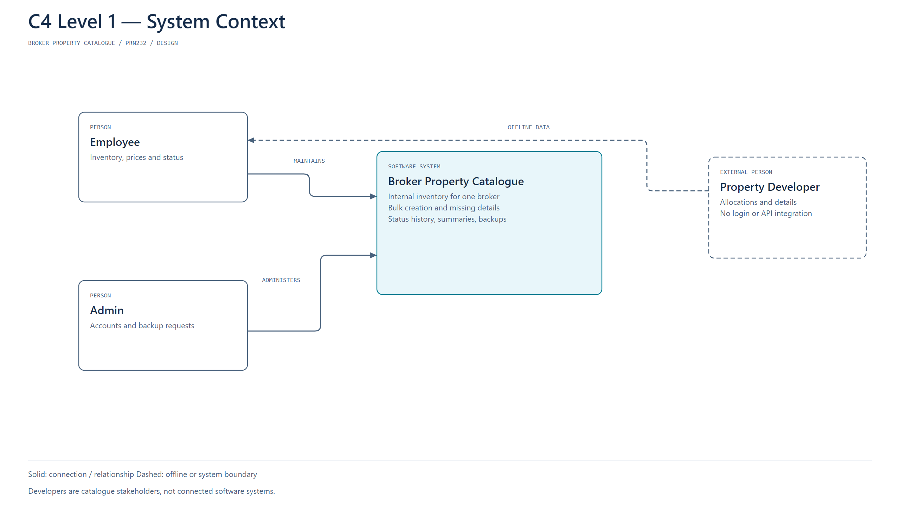

C1 shows Admin and Employee responsibilities and the offline Supplier/Walk-in Customer interactions. Customers and suppliers do not have software access. Redis, PostgreSQL and gRPC are internal containers and therefore belong on C2, not C1.

### 6.2 C2 — Complete Container View

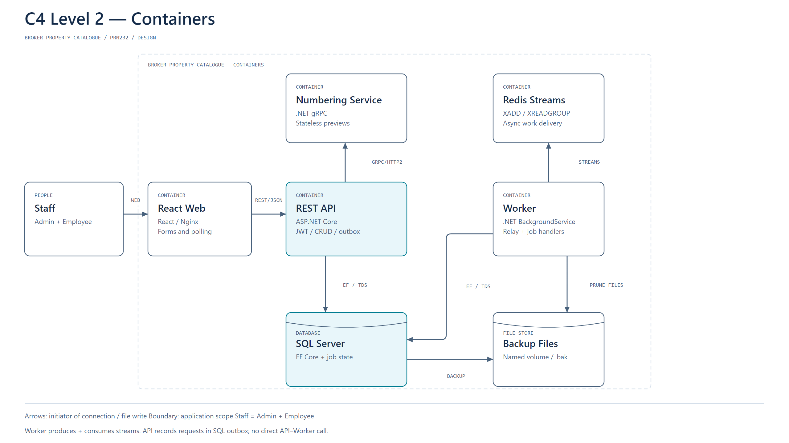

| Container/store | Responsibilities and contracts |
|---|---|
| React Web / Nginx | JWT login, catalogue/metadata forms, advice with reasons, receipt/sale drafts, confirmation feedback, stock counts, Admin review, replenishment inbox, reports/backup results. Proxies `/api`. |
| ASP.NET Core REST API | JWT/roles, Controllers → Services → Repositories, trusted state transitions, transactional stock/ledger/outbox, AutoMapper DTO boundaries, advice/quote orchestration. Hosted outbox relay is the Redis producer. |
| Advisory & Calculation gRPC | Stateless `CalculateTotals` and `RecommendProducts`; deterministic rules/version, no persistence and no direct PostgreSQL/Redis calls. |
| .NET Worker | Redis consumer, current-state low-stock checks, suggestion lifecycle, daily/manual report generation, serial daily/manual pg_dump and retention. |
| PostgreSQL | Authoritative catalogue, stock/version, slips/price snapshots, ledger, count approval, suggestions, outbox and job/report records. Shared by API and Worker for this assignment. |
| Redis Streams | Consumer-group message delivery; AOF/volume enabled. Not the source of truth for available bags. |
| Backup File Store | Named Docker volume with `.dump` archives, written and pruned by Worker. A file store, not an extra microservice. |

Six executing deployments (Web, API, gRPC, Worker, PostgreSQL, Redis) plus the backup volume are sufficient. C2's richer responsibility text and labelled relationships describe these real boundaries; no invented payment/email/AI service has been added.

### 6.3 C2 — Synchronous Advice and Sale View

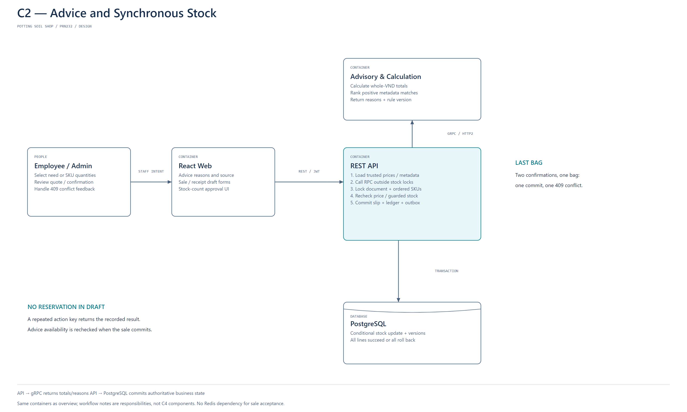

React sends staff intent to API; API loads current catalogue/prices, calls gRPC and returns advice/quote. A sale confirmation then validates the quote against locked current rows and commits all stock/document effects in PostgreSQL. The network RPC is outside the stock-lock transaction, with a short deadline. Replies are implicit on directed request arrows and spelled out in the figure's responsibility notes.

### 6.4 C2 — Async Replenishment, Reports and Backups

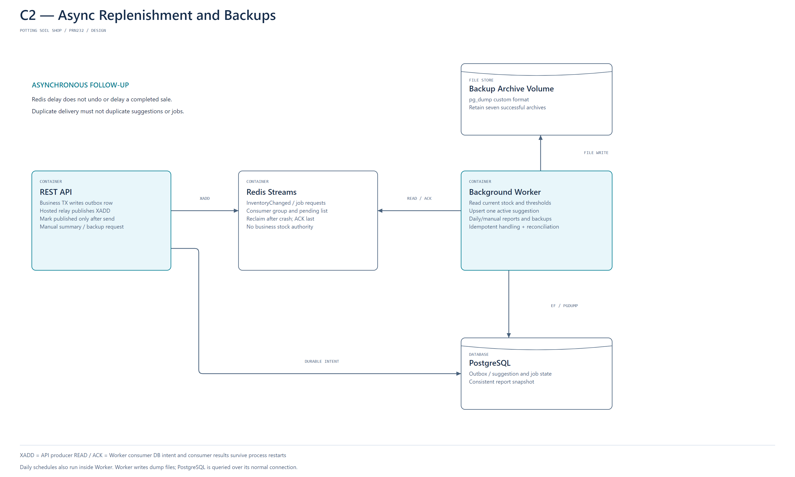

The SQL outbox closes the gap between a committed stock change and Redis publishing. The API relay sends with XADD then records publication. Worker consumes with XREADGROUP, commits an idempotent result, then XACKs. A publish/mark or consume/ACK crash can cause duplicates; unique suggestion/run identities and fresh stock reads make repeated handling safe.

Pending messages are reclaimed with XAUTOCLAIM after a configured idle timeout. Retry transient failures with backoff, persist/log terminal errors, and do not trim unprocessed stream records. For this assignment, one Worker instance owns stateful low-stock handling and serial backups. API mutations emit InventoryChanged; Admin threshold/target/product availability changes emit the same recheck event even without a stock movement.

On startup and a small periodic reconciliation, Worker rechecks active SKUs and nonterminal BackupRuns. This repairs stale alerts or queued backups after broker loss. Redis retention and reconciliation do not replace PostgreSQL correctness. Summaries and backups run in independent hosted loops so a long dump does not block the low-stock consumer.

Only Level 1 and Level 2 C4 views exist. The additional Level 2 views are filtered perspectives on the same containers, not component diagrams.

## 7. Technology

| Area | Selected design baseline |
|---|---|
| Frontend | React + Vite + TypeScript; plain CSS and reusable components; no Ant Design. |
| Backend | .NET 10 LTS / ASP.NET Core Web API; DI, validation, exception middleware, structured logs. |
| Persistence | EF Core 10 + Npgsql EF provider 10; migrations and exported PostgreSQL SQL scripts. |
| Database | PostgreSQL 16 baseline; native numeric/timestamptz/jsonb, explicit bigint version fields. |
| Mapping | AutoMapper for explicit DTO/entity profiles; ignore trusted fields. Document installed version/license configuration; secrets stay outside source. |
| RPC | Grpc.AspNetCore / Grpc.Net.Client / Protobuf; internal HTTP/2 endpoint. |
| Messaging | Redis 7.x Streams, consumer groups, AOF and persistent volume. |
| Background | .NET Worker / BackgroundService; small hosted loops, no scheduler platform dependency. |
| Authentication | JWT bearer, Admin/Employee roles, password hashing, active-account check. |
| Local deployment | Docker Desktop Linux containers and Compose; private service network and separate PG/Redis/backup volumes. |
| Verification | xUnit integration tests against PostgreSQL during implementation; browser flow checks; restore drill. |

The Npgsql provider supports [EF Core 10](https://www.npgsql.org/efcore/release-notes/10.0.html). Pin compatible patch versions/images during implementation. AutoMapper's current [license configuration](https://docs.automapper.io/en/stable/License-configuration.html) must be documented rather than hidden by suppressing logs. No package installation or license purchase is performed by this document.

Expose Web locally; keep Redis/PostgreSQL/gRPC internal unless a development tool explicitly needs a port. Configure gRPC as HTTP/2-only for the private plaintext demo endpoint; use HTTPS when exposing beyond the local demo. No database access from React, direct user-supplied SQL sort fragments, HTML metadata injection or subprocess shell concatenation.

## 8. ERD (Conceptual)

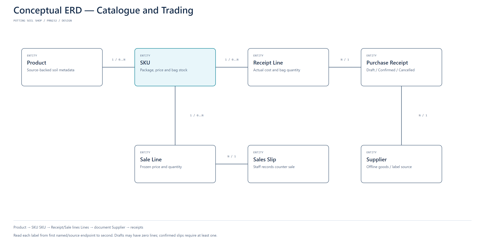

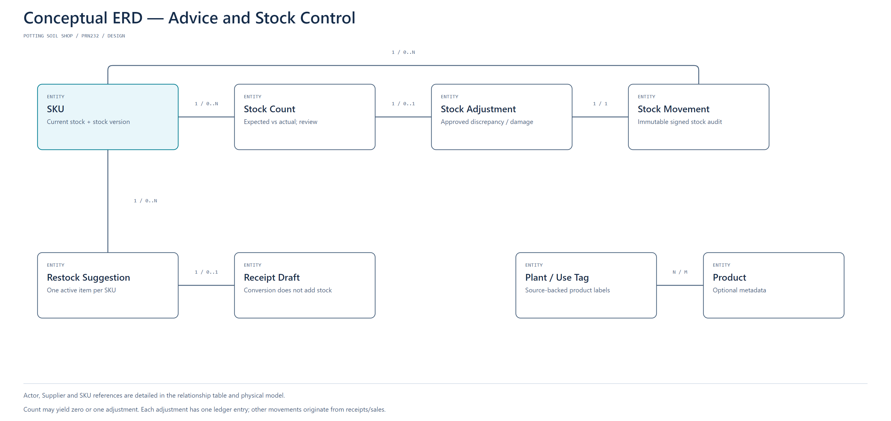

| Relationship | Cardinality / meaning |
|---|---|
| Product → SKU | 1 → 0..many; a SKU has exactly one Product. |
| Product ↔ Plant/Use Tag | Many-to-many through product_plant_tags; tags describe supplied suitability. |
| Supplier → Purchase Receipt | 1 → 0..many; a Receipt has one Supplier. |
| Receipt → Receipt Line → SKU | Receipt has 0..many Draft lines, at least one when Confirmed; each line references one SKU. |
| Sale → Sale Line → SKU | Same line cardinality; no Customer account is required. |
| SKU → Stock Count / Stock Movement / Suggestion | Each SKU has historical records; each record concerns one SKU. |
| Stock Count → Stock Adjustment | 0..1 Adjustment; zero-discrepancy approvals need no movement. |
| Suggestion → Purchase Receipt | 0..1 linked draft receipt per suggestion in this simple conversion flow. |
| User → Documents / Count Decisions | One account can act on many records; every business action records its actor. |

The two figures separate trading from inventory/advisory concepts to avoid a dense graph. They are conceptual ERDs, not C4 Level 3.

## 9. Physical DB

The generated [PostgreSQL schema](database/schema.sql), [data dictionary](database/data-dictionary.md) and schema metadata share one source: `docs/tools/schema_model.py`. The baseline has **18 tables**, with no extension required. It has executed successfully on PostgreSQL 16 in an isolated test container. Review this design against actual EF migrations when implementation starts.

| Tables | Role |
|---|---|
| users, suppliers | Internal roles and supply-side catalogue. |
| products, plant_tags, product_plant_tags, skus | Metadata, tags, package/price identity, stock and concurrency tokens. |
| purchase_receipts, purchase_receipt_lines | Receipt state and actual historical prices. |
| sales, sale_lines | Sale state and frozen sale prices/display labels. |
| stock_counts, stock_adjustments, stock_movements | Physical-count workflow, immutable corrections and complete stock audit trail. |
| restock_suggestions | Idempotent low-stock inbox and receipt-draft conversion. |
| outbox_messages | Transactional intent to publish stock/background requests. |
| daily_summaries, daily_sku_snapshots | Timestamped operational reports and inventory at generation. |
| backup_runs | Scheduled/manual archive requests, results, retention metadata. |

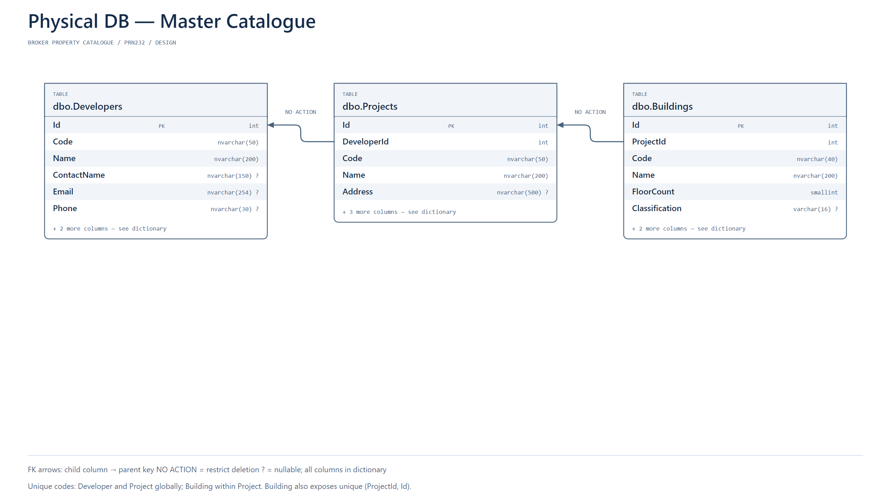
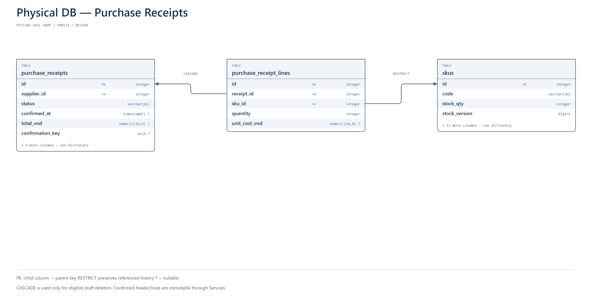
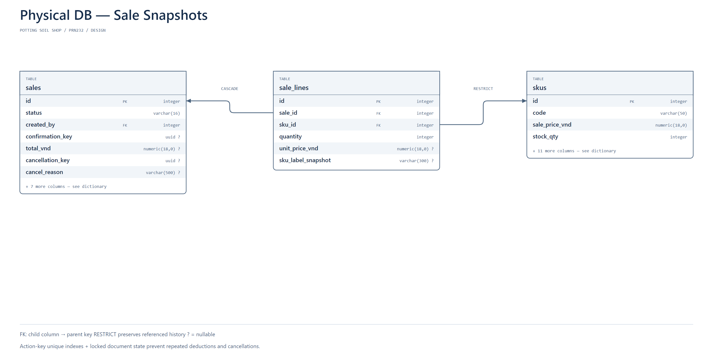
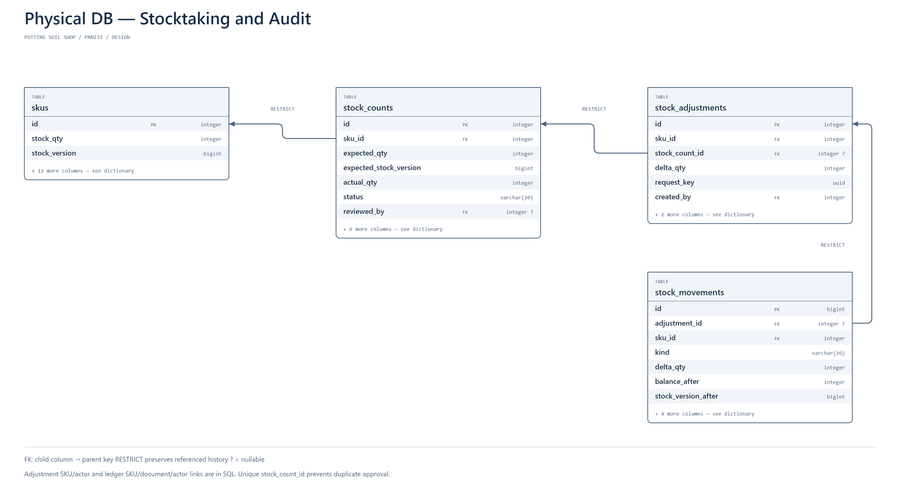
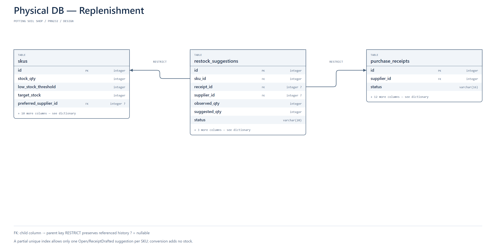
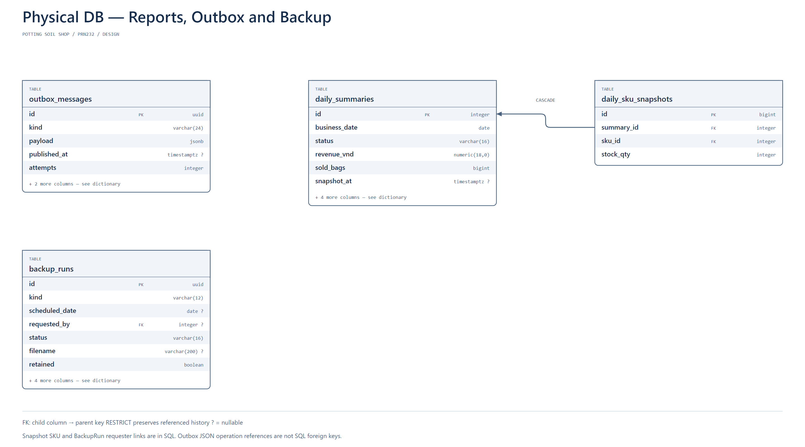
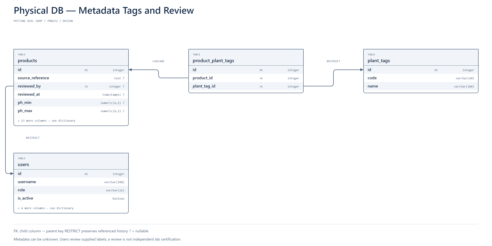

Physical figures show key columns and selected FK edges; overflow counts and captions disclose omitted details. The dictionary lists every column, CHECK, FK and index. Names are PostgreSQL snake_case. All FKs restrict deletion except explicitly shown child cascades; Services allow deleting document drafts only, never confirmed history.

Unique action keys, one active suggestion per SKU, one adjustment per count and one movement per source/SKU/action support idempotent behavior. `stock_qty >= 0` is enforced in PostgreSQL. Cross-table rules—line completeness, sums, state-transition legality, same-SKU count adjustments and ledger correctness—are enforced by Services in the same transaction, not falsely claimed as row-local CHECKs. Whole VND must be validated before PostgreSQL numeric conversion.

## 10. API and Screen Map

| Screen / resource | Main operations |
|---|---|
| Login / `/api/auth/login` | JWT login; no public registration. |
| Accounts / `/api/users` | Admin create/update/deactivate; protect last Admin. |
| Catalogue / `/api/products`, `/api/skus`, `/api/plant-tags` | Admin master CRUD, metadata review/source and pricing; Employee search/read. |
| Suppliers / `/api/suppliers` | Admin master CRUD; Employee selects/reads supplier. |
| Advice / `/api/product-advice` | POST preferences → ranked IDs/reasons, then add chosen SKU to Draft. |
| Purchase receipts / `/api/purchase-receipts` | Draft CRUD; confirm; Admin cancel; frozen history read. |
| Sales / `/api/sales` | Draft CRUD; quote; confirm; Admin cancel. |
| Stock ledger / `/api/stock-movements` | Read-only history by SKU, date, kind, actor/reference. |
| Counts / `/api/stock-counts` | Capture snapshot, submit physical result; Admin approve/reject/recount. |
| Adjustments / `/api/stock-adjustments` | Admin reasoned signed correction; immutable afterward. |
| Replenishment / `/api/restock-suggestions` | List, refresh current suggestions, convert to one receipt Draft. |
| Reports / `/api/daily-summaries` | Date-based read, manual refresh request and status. |
| Backup / `/api/backups` | Admin list, manual request and result; no restore/download endpoint. |

Lists support meaningful search/filter/sort/pagination. Product filters: name/code/tag/known drainage/retention/active; SKU filters: Product, package unit/amount, price range, availability/low-stock. Documents filter by code, status, date and creator; receipts also by Supplier. Default page 20/max 100 and allowlisted sort fields with ID tie-breakers. Operational times are UTC timestamptz; display in Vietnam time.

Errors: 400 for invalid quantities/metadata, 401/403 for auth, 404 for missing resource, 409 for stale data, conflicting document state, duplicate conversion or insufficient stock, 503 for unavailable gRPC. Use ProblemDetails and correlation IDs; suppress database traces from UI. Normal business conflicts must not generate an unhandled server exception.

## 11. Demonstration and Assignment Coverage

1. Admin creates a Product, source-backed tags and 5 kg/10 kg SKUs; leaves an unknown measurement NULL.
2. Employee receives stock with real line prices and confirms a receipt; inspect movement history.
3. Employee requests advice; show explanations and gRPC request/response logs.
4. Two employee sessions try to confirm the last bag; exactly one succeeds, the other sees a conflict. Retry the winning action; no double deduction.
5. Redis event consumption opens/updates a low-stock suggestion; convert it to a receipt Draft without adding stock.
6. Employee counts a mismatch; Admin approves a valid discrepancy. Demonstrate another count becoming stale after a sale.
7. Admin cancels a sale and a sufficiently stocked receipt; show immutable originals and reverse movements.
8. Run manual summary and backup; inspect timestamps/results. Restore archive into a separate database and compare data.

| PDF requirement | Evidence in this design |
|---|---|
| ASP.NET Core REST CRUD / layering | Master and Draft CRUD; Controller → Service → Repository; OpenAPI. |
| JWT / search/filter/sort/pagination | Role policy and resource list contracts. |
| EF Core / relational DB / DI / config / logs / exceptions | Npgsql/PostgreSQL schema and API/Worker service boundaries. |
| Independent gRPC communication | Advice and totals service invoked by API. |
| Broker producer and consumer | API outbox relay XADD; Worker XREADGROUP/XACK. |
| Background service | Replenishment processing, summaries, daily/manual backups. |
| Docker or cloud deployment | Six services in Compose, shared persistent volumes. |
| End-to-end workflow | Receive → advise → sell → replenish → count/reconcile. |
| Deliverables | Source/migrations/SQL, Dockerfiles/Compose, OpenAPI, README and presentation checklist remain tracked. |

## 12. Implementation Sequence and Responsibilities

| Owner | Primary responsibility |
|---|---|
| Member A | API, JWT, EF/Npgsql migrations, transaction/ledger/count approval and AutoMapper contracts. |
| Member B | React screens, table/form components, advice/reasons, document wizard and conflict UX. |
| Member C | gRPC totals/advice, Redis relay/consumer integration, reports/backups and Compose/restore demo. |

Slice 1: Compose infrastructure, auth, catalogue/SKU metadata and DB constraints. Slice 2: receipts/sales, immutable snapshots, last-bag/idempotency verification. Slice 3: advice and explanation UI; low-stock suggestions and draft conversion. Slice 4: physical counts/Admin approval and adjustments. Slice 5: reports/backup/restore, browser integration and presentation. Each slice must demonstrate a complete user behavior; do not build every screen before testing a transaction.

Required application tests include concurrent last-bag sales, partial multi-line rollback, duplicate confirmation/cancellation/adjustment, stale count submission/approval, duplicate restock conversion, source-missing advice, price changes during confirmation, and broker interruption/recovery. The existing SQL prototype validates only the database subset; see [verification](verification.md).

## 13. Technical References

- [PostgreSQL transaction isolation](https://www.postgresql.org/docs/current/transaction-iso.html).
- [EF Core ExecuteUpdate concurrency and transactions](https://learn.microsoft.com/en-us/ef/core/saving/execute-insert-update-delete).
- [Npgsql EF Core 10 provider](https://www.npgsql.org/efcore/release-notes/10.0.html).
- [Redis consumer groups](https://redis.io/docs/latest/commands/xreadgroup/) and [pending reclaim](https://redis.io/docs/latest/commands/xautoclaim/).
- [PostgreSQL pg_dump](https://www.postgresql.org/docs/current/app-pgdump.html) and [pg_restore](https://www.postgresql.org/docs/current/app-pgrestore.html).
- [AutoMapper license configuration](https://docs.automapper.io/en/stable/License-configuration.html).
- [Container growing-media properties, NC State Extension](https://content.ces.ncsu.edu/extension-gardener-handbook/18-plants-grown-in-containers).
